# Automatisations – Données démographiques de Madagascar

Pipeline qui télécharge, nettoie et visualise les données démographiques de Madagascar.

## Tableau de bord interactif

**https://abelmaminiaina.github.io/demographie/**

[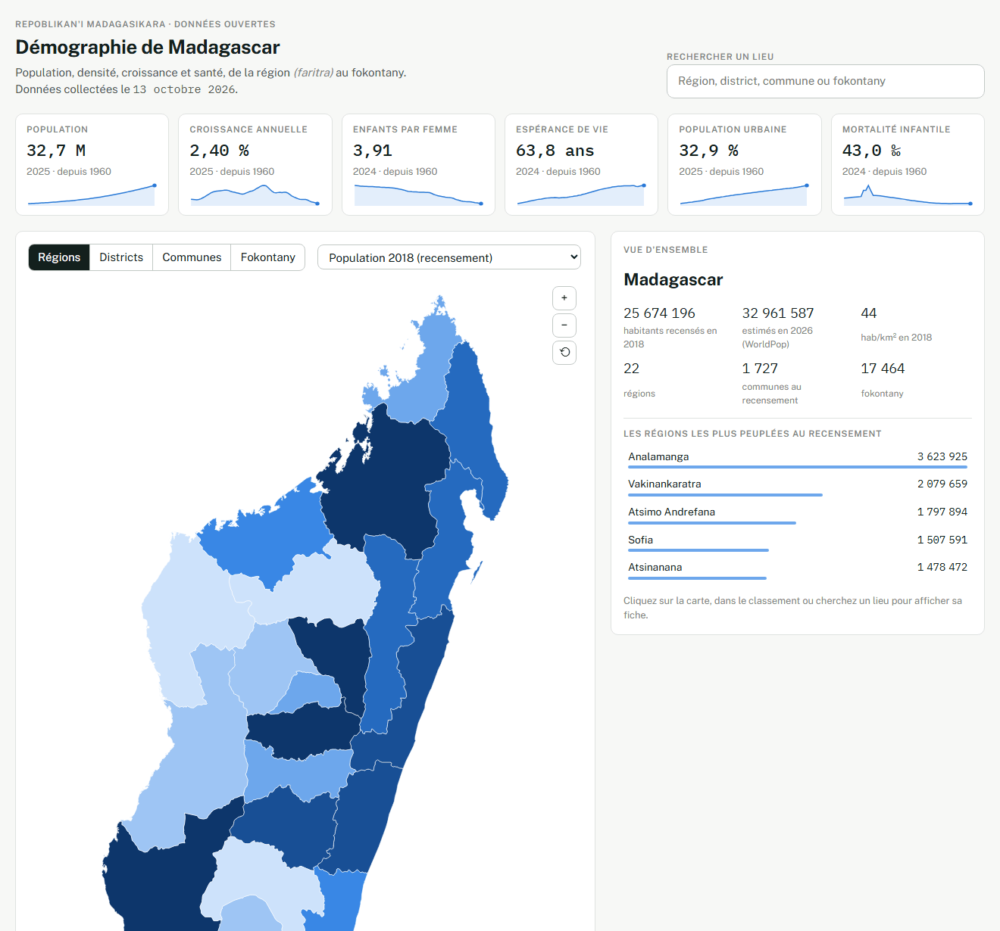](https://abelmaminiaina.github.io/demographie/)

[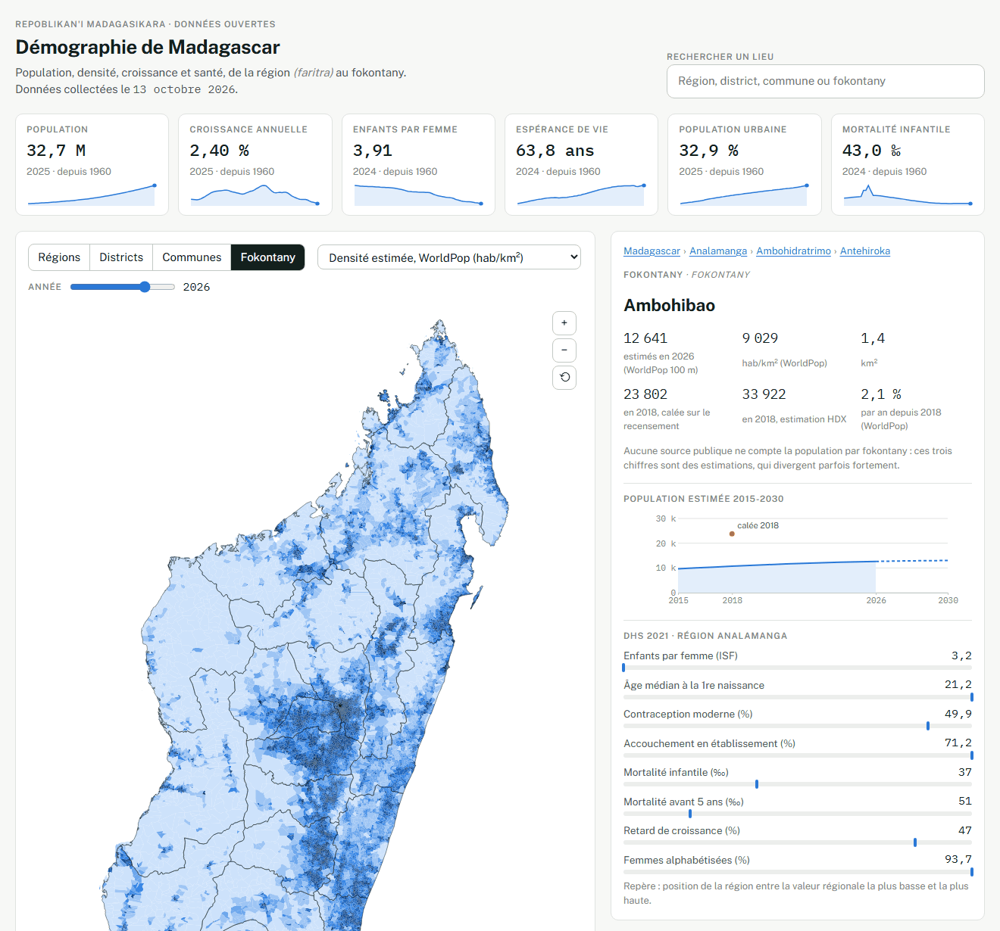](https://abelmaminiaina.github.io/demographie/)

Une carte de Madagascar à quatre niveaux (régions, districts, communes et 17 464 fokontany). Elle propose les résultats du recensement de 2018, les estimations et la croissance WorldPop année par année (grille de 100 m pour les fokontany), la population des fokontany calée sur le recensement, et les indicateurs de santé DHS. Le tableau de bord propose aussi :

- une recherche jusqu'au fokontany ;
- une fiche par lieu (évolution 2015-2030, indicateurs DHS de la région, liste des fokontany d'une commune) ;
- la population de 1960 à 2050 ;
- une pyramide des âges année par année ;
- un classement triable.

La page est un fichier HTML autonome (`sorties/tableau_de_bord/index.html`), régénéré par le pipeline et republié chaque mois sur GitHub Pages. Elle s'ouvre aussi directement depuis le disque. Les captures ci-dessus sont dans `docs/captures/`.

## Aperçu

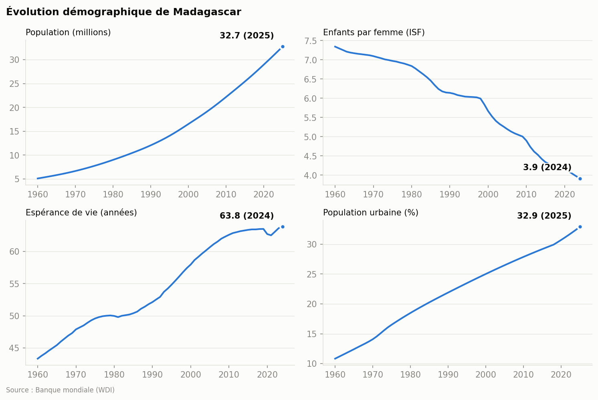

| Population par région | Densité par district |
|---|---|
| 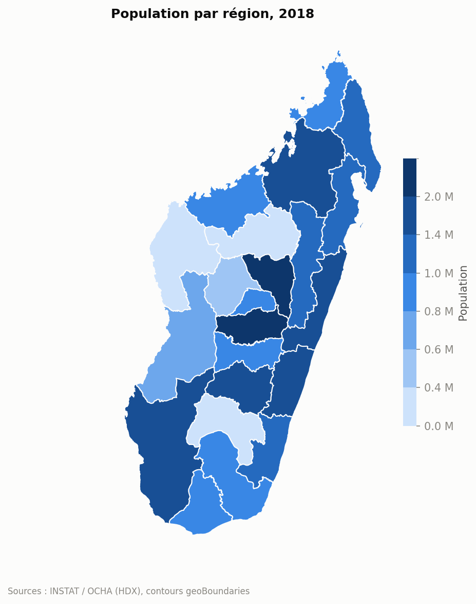 | 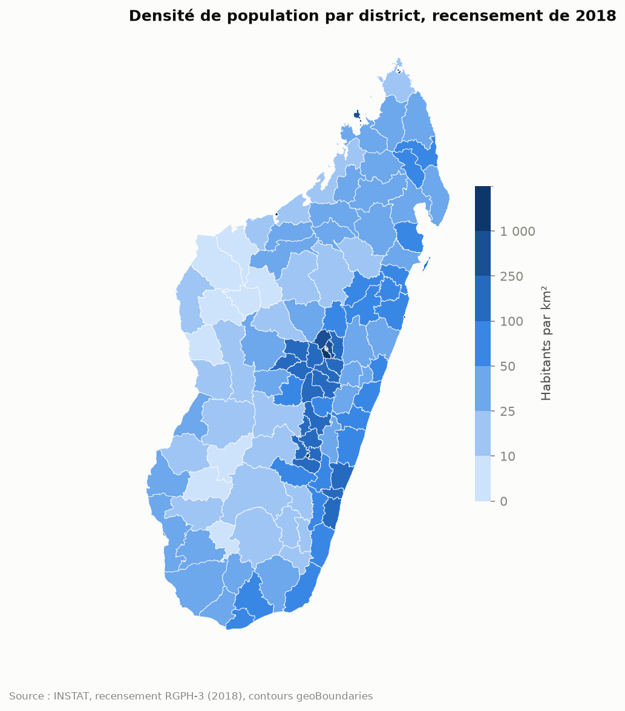 |

| Écart estimation HDX / recensement | Densité par commune (estimation) |
|---|---|
| 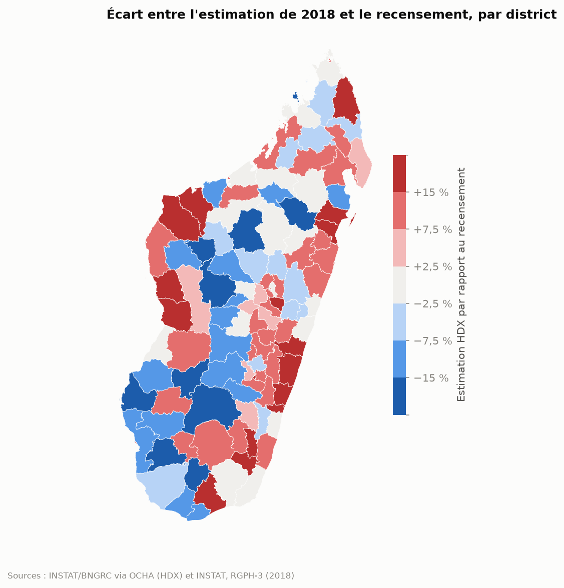 | 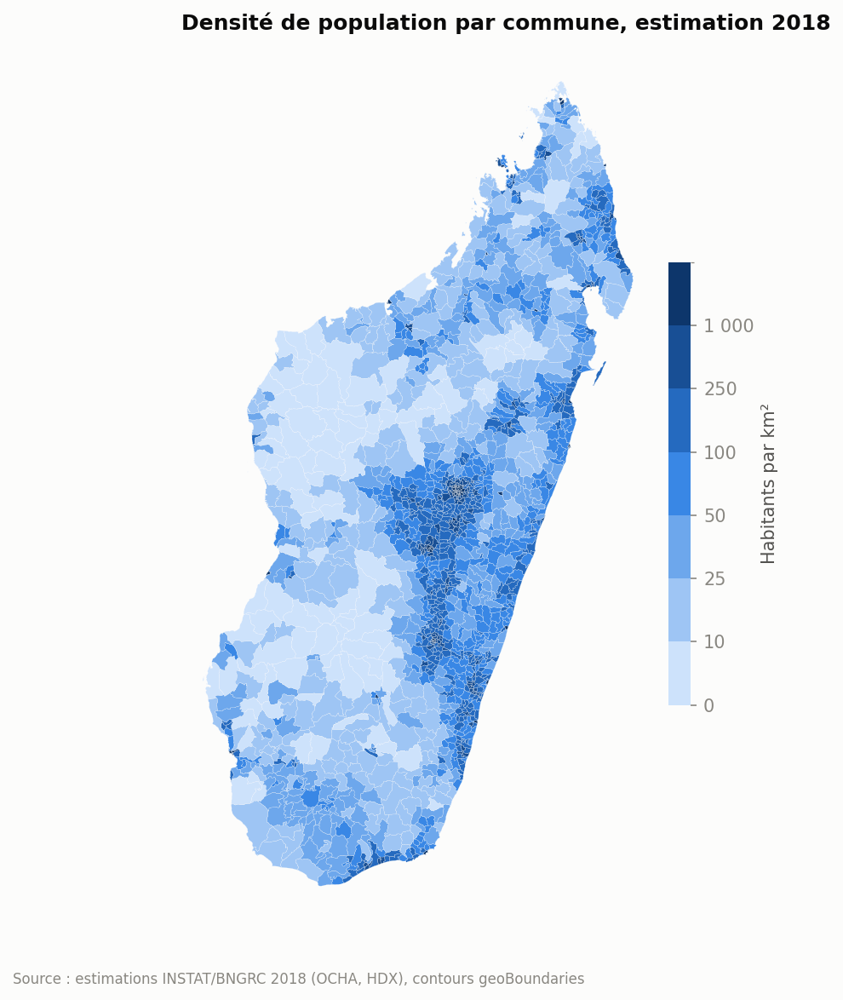 |

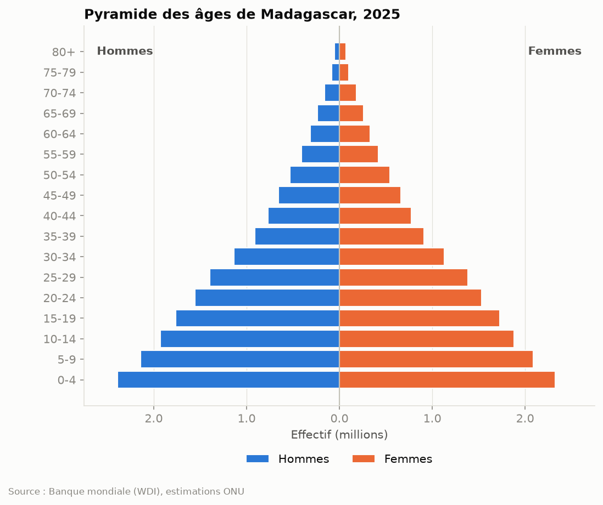

| Fécondité par région (DHS) | Croissance estimée par district (WorldPop) |
|---|---|
| 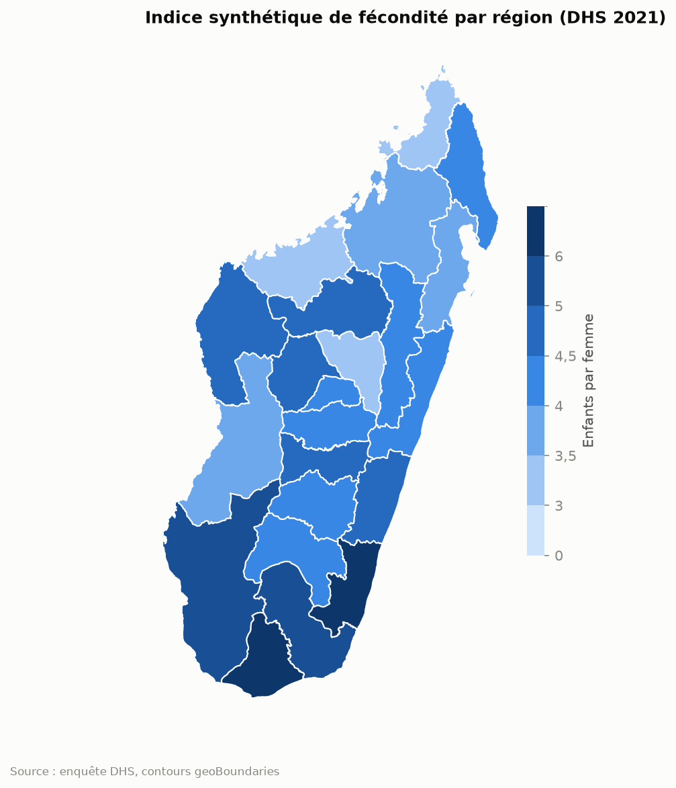 | 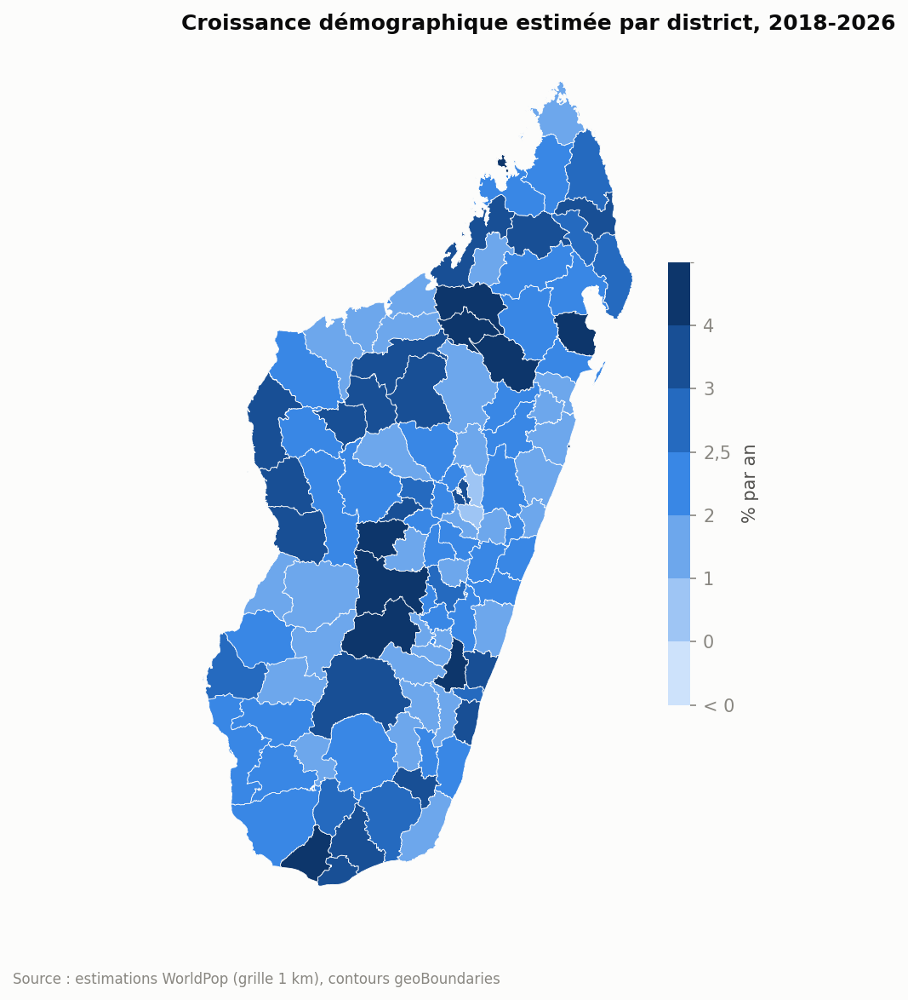 |

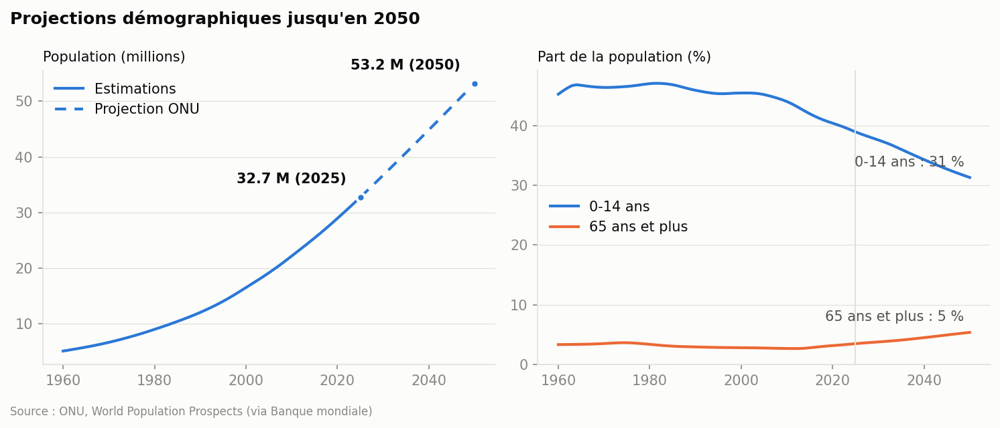

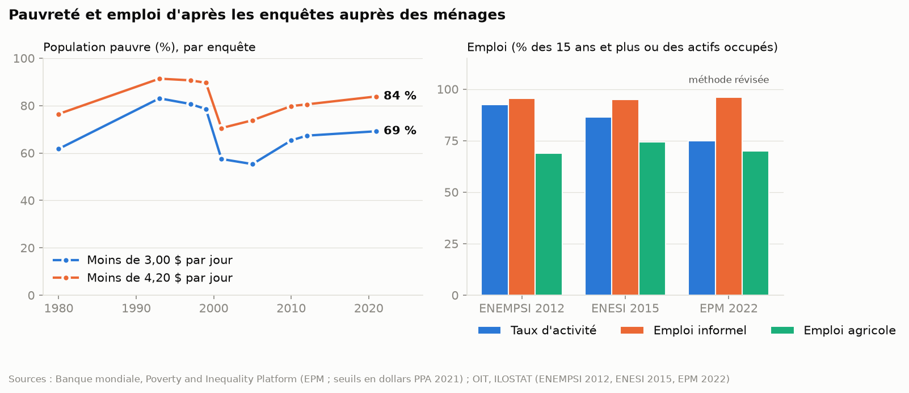

Les graphiques sont régénérés à chaque exécution du pipeline.

## Installation

```bash
pip install -r requirements.txt
```

## Utilisation

```bash
python src/pipeline.py                  # collecte + nettoyage + graphiques
python src/pipeline.py --sans-collecte  # réutilise les données déjà téléchargées
```

## Étapes

| Étape | Module | Sorties |
|---|---|---|
| 1. Collecte | `src/collecte.py` | `data/brut/<source>/`, `journal_collecte.json` |
| 2. Nettoyage et contrôles qualité | `src/nettoyage.py` | `data/traite/<thème>/*.csv` |
| 3. Graphiques et rapport | `src/visualisation.py` | `sorties/` |
| 4. Tableau de bord | `src/tableau_de_bord.py`, `src/modele_tableau_de_bord.html` | `sorties/tableau_de_bord/` |

## Sources des données

Le **[catalogue des données](DONNEES.md)** détaille, pour chaque source, le producteur, l'adresse, la licence, la méthode et les limites. Il décrit aussi le classement des fichiers et chaque colonne des fichiers produits.

| Source | Producteur | Contenu | Licence |
|---|---|---|---|
| Recensement RGPH-3 (PDF officiel, copie UNFPA) | INSTAT | Population 2018 par région, district et commune, par sexe et milieu | Publication officielle, citation obligatoire |
| Banque mondiale | ONU, offices statistiques, Banque mondiale | Séries nationales 1960-2025, pyramide des âges | CC BY 4.0 |
| ONU, World Population Prospects (via la Banque mondiale) | Division de la population de l'ONU | Projections jusqu'en 2050 | CC BY 3.0 IGO |
| HDX `cod-ps-mdg` | INSTAT et BNGRC, diffusé par OCHA | Population 2009-2018 des régions, districts, communes et fokontany | CC BY 3.0 IGO |
| geoBoundaries | OpenStreetMap (régions) ; BNGRC et OCHA (autres niveaux) | Contours administratifs | ODbL 1.0 ; CC BY 3.0 IGO |
| DHS Program | INSTAT et ICF | Santé et fécondité par région (2021) | Données publiques, citation obligatoire |
| OIT, ILOSTAT | INSTAT (enquêtes ENEMPSI, ENESI, EPM) ; OIT (indicateurs) | Activité, chômage, emploi informel, emploi par secteur et statut, 2001-2022 | CC BY 4.0 |
| Banque mondiale, Poverty and Inequality Platform | INSTAT (enquêtes EPM) ; Banque mondiale (indicateurs) | Pauvreté et inégalités, 1980-2021 | CC BY 4.0 |
| WorldPop R2025A | Université de Southampton | Estimations 2015-2030 sur grilles de 1 km (communes, districts, régions) et de 100 m (fokontany) | CC BY 4.0 |

Les cartes des régions et des districts utilisent le **recensement RGPH-3 de 2018** (25 674 196 habitants). Les populations par commune et par fokontany viennent des estimations INSTAT/BNGRC diffusées sur HDX. Pour les fokontany, une estimation calée sur le recensement est aussi produite : la population recensée de chaque commune est répartie entre ses fokontany (`data/traite/recensement/fokontany_estimation_calee_rgph3.csv`). Ces estimations sont calculées à partir des données de 2009 avec un taux de croissance uniforme, et dépassent le recensement de 4 % au total, avec des écarts de −34 % à +47 % selon les districts. Le recensement compte 1 727 communes, contre 1 579 dans le découpage HDX qui sert aux cartes.

Le PDF du recensement est récupéré depuis la copie de l'UNFPA, car le site de l'INSTAT semble compromis (voir le catalogue).

## Harmonisation des noms

Les sources écrivent les noms différemment (« Haute Matsiatra » / « Matsiatra Ambony », « Amoron I Mania » / « Amoron'i Mania »).
`nettoyage.cle_nom()` normalise les noms en gardant les chiffres, ce qui distingue « 2e Arrondissement » de « 3e Arrondissement ». Une nouvelle variante s'ajoute dans `ALIAS_NOMS`.

Beaucoup de communes portent le même nom dans des districts différents, et les contours geoBoundaries n'indiquent pas le district. `nettoyage.rattacher_contours()` le retrouve en cherchant le district qui contient un point intérieur de chaque commune (`src/geometrie.py`), puis relie la commune par le couple (district, nom).

Les fokontany sont rattachés à leur commune de la même façon. Deux fokontany homonymes d'une même commune ne peuvent pas être distingués dans les contours. Ils sont donc fusionnés, et leurs P-codes sont joints par `|`.

Le pipeline s'arrête si une unité reste sans contour, si la somme d'un niveau ne redonne pas la population du niveau supérieur, si une région DHS n'est pas reconnue, ou si le total WorldPop s'écarte de plus de 5 % du total de l'ONU.

Les sources régionales utilisent encore le découpage en 22 régions, où Vatovavy-Fitovinany forme une seule région. La séparation en Vatovavy et Fitovinany (2021) n'y apparaît pas encore.

## Exécution automatique

Le workflow `.github/workflows/mise-a-jour-mensuelle.yml` exécute le pipeline :

- le 1er de chaque mois, pour reprendre les données les plus récentes ;
- à chaque push sur `main` qui modifie le code (`src/`, `requirements.txt` ou le workflow), pour publier aussitôt les changements. Une modification de la documentation seule ne le déclenche pas.

À chaque exécution :

- les graphiques sont recommités seulement s'ils ont changé ;
- chaque requête est retentée jusqu'à 5 fois en cas de coupure réseau ;
- les données et le rapport complet sont téléchargeables 90 jours dans l'onglet **Actions** (artefact `donnees-…`) ;
- un échec (source indisponible, contrôle qualité échoué) déclenche un email de GitHub.

Lancement manuel, si besoin : onglet **Actions**, puis **Mise à jour mensuelle**, puis **Run workflow**.

Le robot commite les graphiques sur `main` : faites un `git pull` avant de modifier le projet.

## Pistes suivantes

- Extraction des tableaux PDF de l'INSTAT, une fois son site sécurisé.
- Base de données (DuckDB/PostgreSQL) pour interroger les séries.
